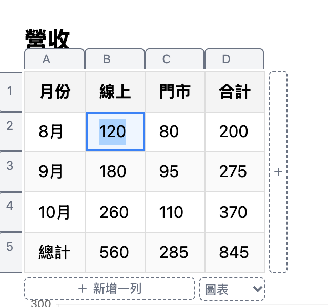
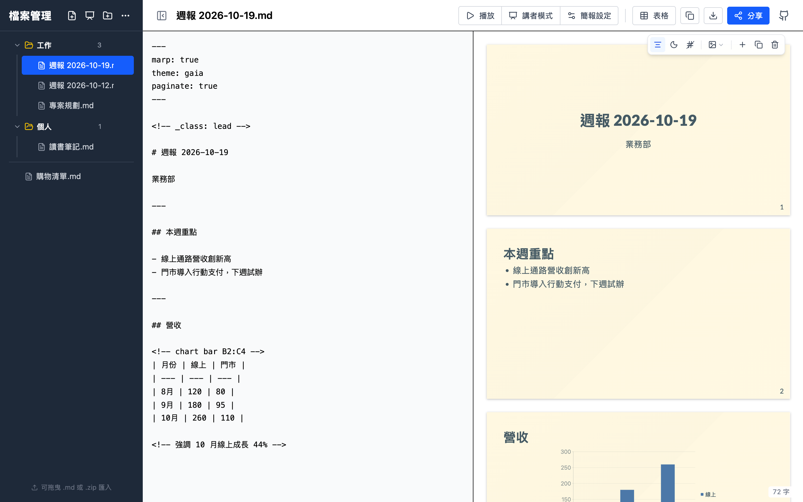
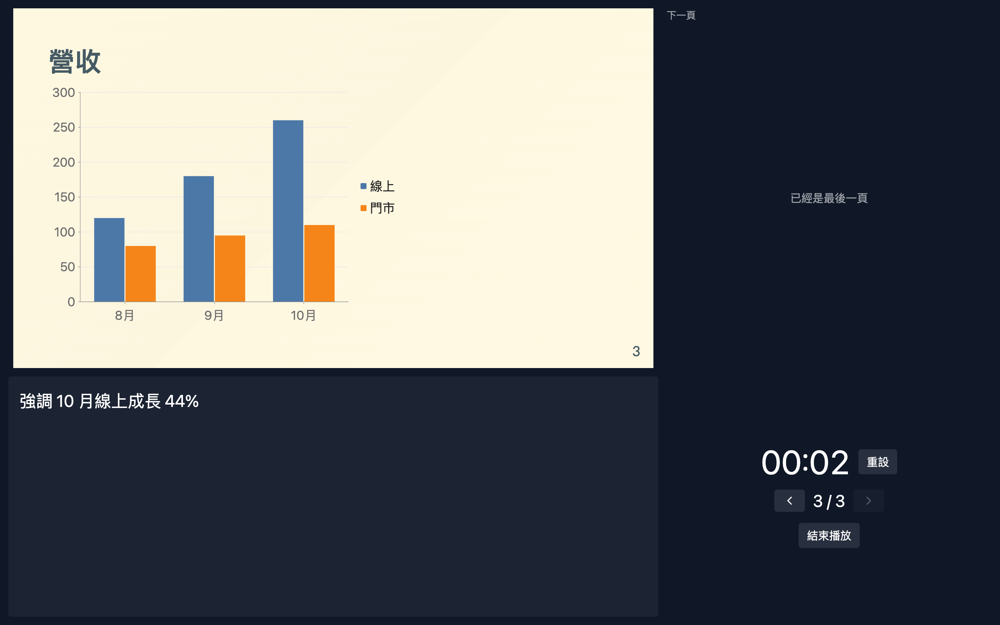

# Markdown Editor Online

**寫文件、算表格、做簡報，都在同一份檔案裡。打開網頁就寫，寫完丟一條連結就能分享。**

> 🔒 不用帳號、沒有雲端、不經過伺服器：檔案存在你的瀏覽器，分享的內容就放在連結本身。

**[👉 線上試用](https://markdown.ericwu.co)** · **[📄 打開一份範例週報](https://markdown.ericwu.co/#s=bZBBTxpREMe_yvRxaRs3wLIS3VgPy7mnpqfigVqSHto1IZjYdJs80ZZF0GwbSrqwbQpEsyEorKmyKvJl2Ddv36lfodlV4qWXSWZ-v0lm_h-JXnhfJCrho_1gVhfUY789skQ2t_RyUS8TlSSAD4egyCCod4fzel5PJACdoaAeHp9yfxaN1h5JEmy-LZTK8LpQAk1WcwpI0npeN0DQdjgZgQG8c4auDQaw0Ylod8AAsdtE0-JHVTAiU5Ik-E-NEJ-0A_8ADEjLqahmVsCAZzk5qclP06nUnSRalPkVMGA1clbSsZJJapkHBWtX3J6CAdlIyWZjRUlqyoPCLDN0zQi8ePn8sSarmvJk0eWix-Iut5zUlhdLcSaBH0c4-xzOTqKRBK92NgC__-HWF3bWQ_OSdX6J43pMYOP-2rDvhOcuXuxyt46DXugeLThet1jFRsdEZ4-Pu_fhr4OgdnBzi61qcHPJxh5zXEFt7P0UtM8vrLDf_TttBNNrdA6Z7Qb-AZ5_Q6fGaiN0hnNawUZtThvs9AeaFppfeXsfB03smnN6yMZeuHcbVgds4mHzak4reZ0skVKx8GZLf_eBqOXSdvHTPw)**（整份文件就在這條連結裡）· [使用說明](docs/guide.md) · [回報問題](https://github.com/skynocover/markdown-editor-online/issues)

[](LICENSE)
[](#參與貢獻)

## 一份週報走一遍

**① 在本機寫週報。** 左邊寫，右邊即時預覽，檔案自動存在瀏覽器裡。


**② 用表格算數字、畫成圖。** 合計欄寫公式，表格上方加一行 `<!-- chart bar B2:C4 -->` 就畫出長條圖。不想記語法的話，在預覽點一下表格，用欄號、列號和「圖表」選單操作。



**③ 開會前變成簡報。** 在開頭加 `marp: true`，用 `---` 分頁，同一份內容就變成投影片。主題、深色、背景圖都能在預覽上直接調整。



上台時開「講者模式」，講者視窗會顯示備註、下一頁和計時。



**④ 會後把連結丟給主管。** 選「唯讀」，複製連結。


對方點開就能看、也能直接播放，不用登入。想修改的話，按「存成我的檔案」存一份到自己的瀏覽器。


## 能做什麼

| 平常用 | 在這裡怎麼做 |
| --- | --- |
| Word | 標題、清單、待辦事項、流程圖 |
| Excel | 表格寫 `=SUM(B2:B4)` 會自動計算；從 Excel 複製貼上就變成表格；表格可以直接畫成長條圖、折線圖、圓餅圖 |
| PPT | 檔案開頭加一行 `marp: true` 就變成投影片：全螢幕播放、講者模式、講者備註 |

另外：檔案有資料夾可以整理，能一鍵匯出成 zip 備份；分享連結可以設成唯讀或加密碼。不熟 Markdown 也能用：會 `#` 標題、`-` 清單就夠了，表格有按鈕可以插入，也能直接在預覽裡點格子修改。

## 跟其他工具比

臨時要寫週報、會議紀錄或報價給別人看，Office 要三個檔案寄來寄去，雲端文件要登入、設權限，用完也沒人回頭刪。這個編輯器把這些拿掉：

| | 這個編輯器 | 雲端文件（Google Docs、Notion 等） | Office 檔案 |
| --- | --- | --- | --- |
| 需要帳號 | 不用 | 要 | 不用 |
| 對方要有什麼才打得開 | 瀏覽器 | 瀏覽器，通常還要登入 | Office 軟體 |
| 資料存在哪 | 你的瀏覽器 | 服務商的伺服器 | 你的電腦 |
| 怎麼分享 | 一條連結，伺服器沒有副本 | 設定權限的連結 | 寄檔案 |
| 文件、表格、簡報 | 同一份檔案 | 分成不同文件或工具 | 三個程式、三個檔案 |
| 多人即時協作 | ❌ 不支援 | ✅ | 視版本而定 |

**適合**：週報、會議紀錄、臨時要給別人看的清單或報價、開一次會就用完的簡報、不想放上雲端的私人筆記。

**不適合**：多人同時編輯、需要長期保存而且不能遺失的正式文件、需要跟 Word／Excel／PowerPoint 檔案來回轉換的工作。

## 設計取捨

「不用帳號、沒有雲端」是刻意選的架構，不是附帶效果。每個選擇都有好處，也有代價：

| 選擇 | 好處 | 代價 |
| --- | --- | --- |
| **沒有後端**，整個程式是靜態網頁 | 不用帳號、沒有追蹤；可以架在任何靜態主機，沒有伺服器費用；沒有資料庫可以外洩 | 沒有雲端同步；不能多人即時協作 |
| **檔案存在瀏覽器的 localStorage** | 打開就能寫；資料不離開你的電腦 | 只存在這個瀏覽器，換瀏覽器或電腦就看不到；清除網站資料就會消失；容量大約 5MB；要自己定期匯出備份 |
| **分享內容放在網址 `#` 後面**（瀏覽器不會把這段送給伺服器） | 伺服器看不到內容；對方不用登入；不需要管理或刪除分享 | 連結發出去就**收不回來，也不會過期**；文件越長連結越長，超過約 2000 字元可能被 LINE、簡訊截斷 |
| **密碼在瀏覽器裡用 AES-GCM 加密**（[原理](docs/share-encryption.md)） | 連結被別人看到也打不開；伺服器從頭到尾看不到密碼 | 忘記密碼無法找回；密碼要用別的管道告訴對方 |
| **唯讀只是畫面模式** | 對方想改的話，一鍵就能存成自己的檔案 | 不是權限控管：拿到連結的人就拿得到全文 |
| **檔案格式是純 Markdown** | 任何文字編輯器都能打開；GitHub、Obsidian 看得懂（公式和圖表會顯示成一般表格）；容易用 git 追蹤版本 | 不能開或存 `.docx`、`.xlsx`、`.pptx`；排版自由度比不上 Office |
| **公式和圖表自己實作** | 程式小，不用載入試算表引擎 | 公式只能參照同一個表格，欄位到 Z 為止，只有 `SUM`、`AVG`、`MIN`、`MAX`、`COUNT` |
| **簡報引擎用到才載入** | 一般文件不用下載 | 第一次開簡報要下載約 1.2MB（gzip） |

## 快速開始

### 直接使用

打開 [markdown.ericwu.co](https://markdown.ericwu.co) 就能開始寫。記得定期用「全部匯出」備份成 zip。

### 自己架設

需要 Node.js 20.19 以上和 [pnpm](https://pnpm.io/)。

```bash
git clone https://github.com/skynocover/markdown-editor-online.git
cd markdown-editor-online
pnpm install
pnpm dev      # 開發伺服器 http://localhost:5173
pnpm build    # 打包到 dist/
```

`dist/` 是純靜態檔案，可以直接放到 GitHub Pages、Cloudflare Pages、Netlify、Vercel 或任何靜態主機，不用設定後端或資料庫。

## 使用說明

完整的語法和操作說明在 **[docs/guide.md](docs/guide.md)**：

- [編輯與預覽](docs/guide.md#編輯與預覽)：快捷鍵、Excel 貼上、在預覽編輯表格
- [表格公式](docs/guide.md#表格公式)：支援的運算和函式、錯誤值
- [圖表](docs/guide.md#圖表)與[表格圖表](docs/guide.md#表格圖表)：mermaid 和 `<!-- chart -->` 註解
- [檔案管理](docs/guide.md#檔案管理)：資料夾、匯入匯出
- [簡報](docs/guide.md#簡報)：Marp 語法、播放、講者備註
- [分享連結](docs/guide.md#分享連結)：可編輯、唯讀、密碼

## 技術架構


| 用途 | 套件 |
| --- | --- |
| 介面 | [React 19](https://react.dev/)、[Vite](https://vite.dev/)、[Tailwind CSS 4](https://tailwindcss.com/)、[lucide-react](https://lucide.dev/) |
| Markdown | [marked](https://marked.js.org/)、[DOMPurify](https://github.com/cure53/DOMPurify)（過濾 XSS） |
| 簡報 | [Marp Core](https://github.com/marp-team/marp-core) |
| 圖表 | [Pele](https://pele.run)（把 mermaid 畫成 SVG） |
| 匯入匯出 | [fflate](https://github.com/101arrowz/fflate)（zip） |
| 分享加密 | 瀏覽器內建的 Web Crypto API |

表格公式、Excel 貼上、表格轉圖表都是專案自己寫的。Marp 和圖表引擎都是延遲載入：只有開啟簡報、遇到 mermaid 區塊時才會下載。

## 參與貢獻

歡迎回報問題、提出建議或送 Pull Request。

1. Fork 這個專案，從 `main` 開一個新分支
2. 修改程式，並補上對應的測試
3. 確認檢查都通過：

   ```bash
   pnpm lint
   node --test src/*.test.js   # 單元測試，用 Node 內建的 test runner
   pnpm build
   ```

4. 送出 Pull Request，說明改了什麼、為什麼要改

新功能請盡量維持「不用帳號、沒有雲端」的原則；比較大的功能，或需要後端的功能，請先開 issue 討論。

## 致謝

- 靈感來自 [Tiny Little Office](https://tinylittleoffice.com/#/)
- 簡報功能建立在 [Marp](https://marp.app/) 上，圖表由 [Pele](https://pele.run) 繪製

## License

[MIT](LICENSE)
