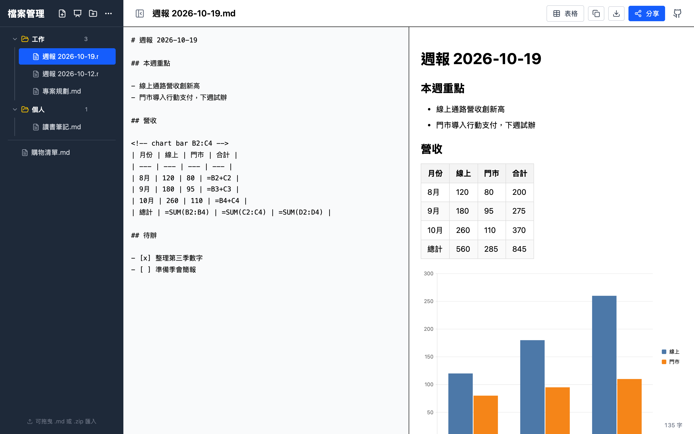
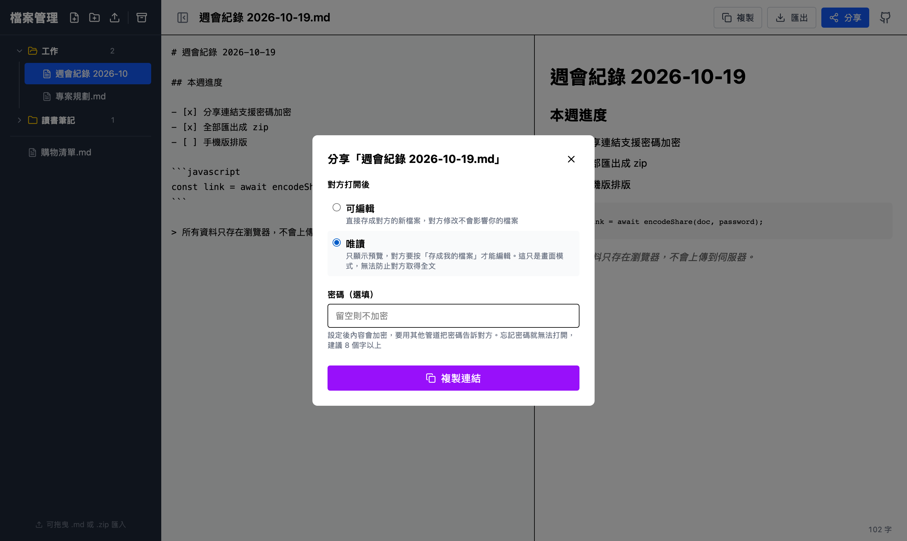
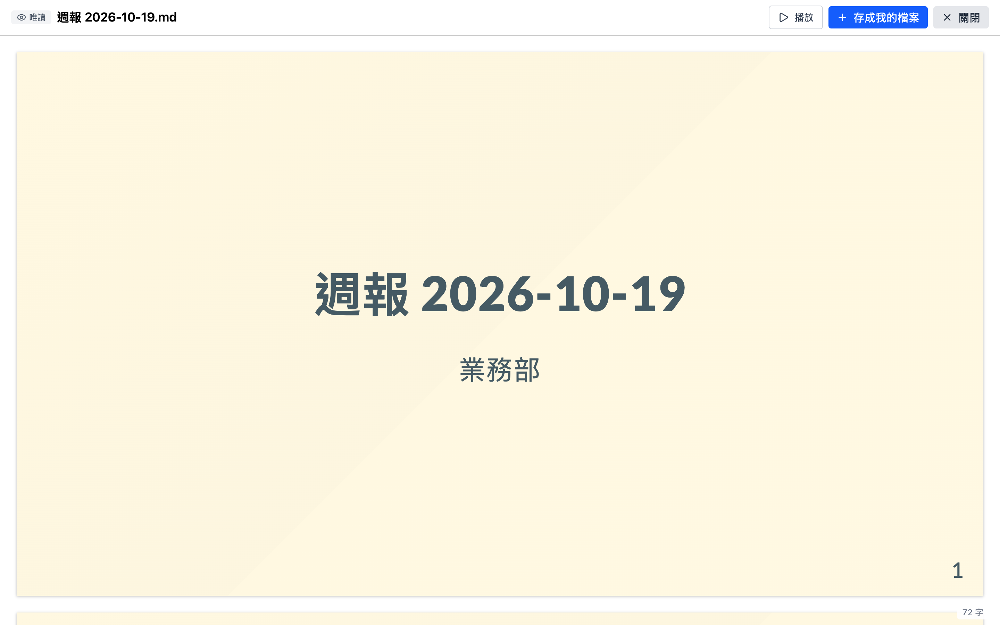

# Markdown Editor Online

一個純前端、開了就能用的 Markdown 編輯器。不用註冊、沒有後端：筆記都存在瀏覽器的 localStorage，分享連結把內容壓縮後放在網址 `#` 後面，不會送到任何伺服器。



## 功能

### 編輯與預覽

- 左邊寫 Markdown，右邊即時預覽（[marked](https://marked.js.org/)，單換行就會換行）
- 預覽內容經 [DOMPurify](https://github.com/cure53/DOMPurify) 過濾，貼上來路不明的 Markdown 也不會跑出 XSS
- 從 Excel、Google Sheets 複製表格後貼上，自動轉成 Markdown 表格（第一列當表頭），按一次 Ctrl+Z 就能復原；想貼原文就用「貼上為純文字」（Ctrl+Shift+V，Safari 是 Cmd+Option+Shift+V）
- 在預覽點表格的格子就能直接編輯：Enter 往下、Tab／Shift+Tab 左右、Esc 取消；可以新增、刪除、拖曳欄列，公式的座標會跟著改；寫公式時點別格會帶入座標，拖曳會帶入範圍
- 工具列「表格」按鈕插入空白表格；預覽裡的待辦清單 `- [ ]` 可以直接打勾
- Ctrl+B／Ctrl+I（Mac 是 Cmd）切換粗體、斜體；在預覽做的修改都能用 Ctrl+Z 還原
- 右下角顯示字數：只算預覽後看得到的字，不算 Markdown 符號和空白，組合 emoji 算一個字
- 一鍵複製 Markdown 原文，或把目前檔案下載成 `.md`

### 表格公式

表格裡以 `=` 開頭的儲存格，預覽時會顯示計算結果；原文、存檔和分享連結裡還是公式。

```markdown
| 品項 | 數量 | 單價 | 小計 |
| --- | --- | --- | --- |
| 咖啡 | 2 | 80 | =B2*C2 |
| 蛋糕 | 1 | 1,200 | =B3*C3 |
| 合計 | | | =SUM(D2:D3) |
```

- 座標跟試算表一樣：欄由左到右是 A、B、C…（最多到 Z），表頭是第 1 列，第一筆資料是第 2 列；不分大小寫，只能參照同一個表格
- 支援 `+ - * /`、括號、負號，以及 `SUM`、`AVG`、`MIN`、`MAX`、`COUNT`；範圍 `B2:B100` 超出表格的部分會自動略過，範圍裡的空白和文字也會略過
- 數字可以帶千分位（`1,200`）或百分比（`5%` 是 0.05）；結果一律加千分位顯示（`20,500`），最多 2 位小數（`333.33`），被其他公式參照時仍用完整數值計算
- 貨幣符號（`$30`）會被當成文字，單位請寫在表頭，例如「單價（元）」
- 錯誤值：`#REF`（參照超出表格）、`#CYCLE`（循環參照）、`#ERR`（其他錯誤，例如語法錯誤、文字參與運算、除以零）
- 想顯示 `=` 開頭的文字，寫成 `\=`
- 簡報裡的表格也會計算，規則一樣

### 圖表

語言標成 `mermaid` 的程式碼區塊，預覽會畫成圖；原文、存檔和分享連結裡還是 mermaid 語法，在 GitHub、Obsidian 也看得到同一張圖。

````markdown

````

- 流程圖、時序圖、圓餅圖、長條／折線圖（`xychart-beta`）等，支援的類型見 [Pele](https://pele.run)
- 簡報裡也能用，圖會縮到投影片放得下，深色頁的圖會跟著變淺色
- 語法錯誤時顯示原文和出錯的行號，其他內容照常顯示
- 圖表引擎只有遇到 mermaid 區塊才載入，而且只載入用到的圖表類型
- 不支援：`click` 連結、外部圖片；圖太大（原文超過 2 萬字、超過 1000 條連線）不會畫

### 表格圖表

在表格**正上方**（中間不能有空行）加一行註解，預覽就在表格下方把資料畫成圖；表格改了圖跟著變。註解在 GitHub、Obsidian 看不見，那邊只看到表格。

```markdown
<!-- chart bar B2:C4 -->
| 月份 | 線上 | 門市 |
| --- | --- | --- |
| 1月 | 120 | 80 |
| 2月 | 180 | 95 |
| 3月 | =B2+B3 | 110 |
```

- 類型：`bar`（長條）、`line`（折線）、`pie`（圓餅，只能選一欄）
- 範圍跟公式一樣用 A1 座標；標籤是同一列的第一欄，系列名稱是表頭，多欄就是多個系列；超出表格的部分自動略過，可以先寫 `B2:B100` 預留
- 公式格用計算結果的完整精度；整列或整欄都不是數字就略過，其他空白、文字當 0；範圍裡有 `#ERR` 等錯誤就不畫，顯示是哪一格
- 不用記語法：在預覽點表格，「新增一列」右邊的「圖表」選單可以插入圖表（自動選數字欄、排除最後的合計列）、換類型、選範圍、移除圖表
- 選範圍：在表格上拖曳，放開就寫回；點欄號選整欄，Shift 加選；選錯按 Ctrl+Z，Esc 結束
- 刪除、搬動欄列時，註解的範圍跟公式一樣自動修正
- 簡報裡有圖表註解的表格**只顯示圖**，不顯示表格（投影片放不下兩個）；想讓觀眾看數字，另一頁放一份沒有註解的表格。簡報預覽沒有表格工具，註解要自己寫，或先在一般模式做好再加 `marp: true`

### 檔案管理

- 多檔案，可以建資料夾（一層），拖曳檔案就能換順序或搬到別的資料夾
- 新檔案沒取名的話，會自動拿第一行的前 20 個字當檔名
- 把 `.md` 或 `.zip` 拖進側邊欄就能匯入
- 「全部匯出」把所有檔案打包成 zip，資料夾對應到 zip 裡的目錄，之後可以原樣匯回來
- 側邊欄可以收合，專心寫字

### 簡報

- 側邊欄「新增簡報」會建一份範本；或在檔案開頭加上 front matter `marp: true`，預覽就會變成投影片
- 用 [Marp](https://marp.app/) 語法：`---` 分頁、`theme: gaia` 換主題、`<!-- _class: lead -->` 置中標題頁、`` 左文右圖、`paginate: true` 頁碼
- 在預覽上調整：「簡報設定」可以換主題、比例、整份改成深色、開關頁碼、改頁首和頁尾；滑鼠移到投影片上（觸控裝置點一下），右上角可以設成置中、深色、隱藏這頁的頁碼，加背景圖（貼圖片網址，再調位置、寬度、填滿方式、亮度、透明度、色調，拖拉桿時預覽即時更新），或在後面新增、複製、刪除這一頁。每個按鈕只改原文的一行（深色會連同有寫 `_class` 的頁一起改），Ctrl+Z 可以還原
- 「播放」全螢幕放映：← → 或空白鍵換頁、點畫面左側上一頁，Esc 離開；唯讀分享連結也能播放
- 講者備註：投影片裡設定以外的 HTML 註解，例如 `<!-- 先自我介紹 -->`，會顯示在預覽每張投影片下方，放映時看不到
- 「講者模式」另開講者視窗，顯示目前頁、下一頁、備註、經過時間；兩個視窗同步換頁，在任一邊按 Esc 結束。主視窗拖到投影機後按 F 全螢幕
- 備註是原文的一部分：用分享連結分享時，對方打開原文也看得到備註
- Marp 只有遇到簡報才載入（約 1.2MB gzip），一般文件不受影響

### 分享連結



- **可編輯**：對方打開後直接存成自己的新檔案，改了也不會動到你的
- **唯讀**：對方只看到預覽，要按「存成我的檔案」才能編輯（這只是畫面模式，不是權限，拿到連結就拿得到全文）
- **密碼**：填了就用 AES-GCM 加密，金鑰由密碼經 PBKDF2（60 萬次）產生。密碼要用別的管道告訴對方（原理見 [docs/share-encryption.md](docs/share-encryption.md)）

對方用唯讀連結打開時看到的畫面：



> 內容整份放在網址裡，所以文件越長連結越長。超過約 2000 字元時，LINE、簡訊這類地方可能會截斷連結，編輯器會提醒你。

## 資料存在哪裡

- 所有檔案都在**這個瀏覽器**的 localStorage，換瀏覽器或清除網站資料就會不見，記得定期「全部匯出」備份
- localStorage 大約只有 5MB，滿了會跳提醒

## 開發

```bash
pnpm install
pnpm dev        # 本機開發
pnpm build      # 打包到 dist/
pnpm lint

# 單元測試（Node 內建 test runner）
node --test src/*.test.js
```

技術：React 19、Vite、Tailwind CSS 4、marked、Marp（簡報）、Pele（mermaid 圖表）、DOMPurify、fflate（zip）、lucide-react（圖示）。

主要檔案：

| 檔案 | 內容 |
| --- | --- |
| `src/markdown-editor.jsx` | 整個編輯器介面 |
| `src/share.js` | 分享連結的壓縮、加密與解碼 |
| `src/backup.js` | 全部匯出／匯入 zip |
| `src/file-name.js` | 從內容產生自動檔名 |
| `src/table-formula.js` | 表格公式的解析與計算 |
| `src/preview-edit.js` | 在預覽編輯表格、勾選 checkbox，寫回原文 |
| `src/slides.js` | 判斷是否為簡報、延遲載入 Marp、簡報範本 |
| `src/diagram.js` | mermaid 圖表的按需載入與渲染 |
| `src/table-chart.js` | 表格上方的圖表註解、表格資料轉成 mermaid |
| `src/speaker-view.jsx` | 講者模式視窗的畫面 |
| `src/slide-tools.jsx` | 簡報設定面板和投影片上的單頁工具列 |
| `src/tip.jsx` | 滑鼠移上去立刻出現的按鈕提示 |

## 靈感來源

靈感來自 [Tiny Little Office](https://tinylittleoffice.com/#/)。

## License

[MIT](LICENSE)
